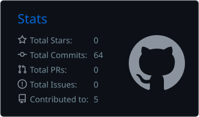
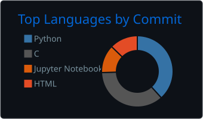

<h1 align="center">Hi, I'm Rohith Kotte 👋</h1>

  <b>AI/ML Engineer · Full Stack Developer · Machine Learning · GenAI</b> 

  

  
  
  <!-- Uncomment once your website is live:
  
  -->

---

## About me

- 🎓 Computer Science (AI &amp; ML) undergraduate 
- 🤖 I love building AI-powered products, from Generative AI and LLM apps to complete ML systems: collecting the data, training the model, serving it through an API and putting it on a website people can use
- 🏆 Hackathon participant, and I volunteer on organizing college hackathons with the **AIML Club**
- 🎯 Interested in **AI/ML Engineering, Data Science, Generative AI / LLM apps, Full Stack Developer and Software Development** roles
- 🌱 Currently learning: Deep Learning, LLMs &amp; RAG, Data Structures &amp; Algorithms, Cloud &amp; MLOps

---

## Featured project

### 🌍 [OzoneGuard AI](https://github.com/rohithk2626/OzoneGuard-AI)
**Ground-level ozone and UV forecasting for any point in India.**

A full-stack ML web app that combines satellite, atmospheric and weather data and forecasts the next 24 hours of ozone and UV.

- Trained **XGBoost** and **LSTM** models for hourly 24-hour forecasts, each with a calibrated **90% prediction interval**
- Brings together **NASA OMI** satellite ozone, **CAMS** air-quality data and **Open-Meteo** weather into one **FastAPI** backend
- Interactive map with GPS and search, WHO UV risk levels, and history and analytics going back to 2022
- **Firebase** login with saved places, **pytest** test suite running on **GitHub Actions**, and detailed docs on the methods, data leakage checks and limitations

`Python` `FastAPI` `XGBoost` `PyTorch` `scikit-learn` `Pandas` `Firebase` `JavaScript` `GitHub Actions`

<!-- Add more projects here as you build them, using the same format. -->

---

## Tech stack

**Languages** 

**AI / ML &amp; Data** 
 

**Backend &amp; Frontend** 

**Databases** 

**Tools &amp; Cloud** 

---

## GitHub stats

<!-- These cards are generated by .github/workflows/profile-cards.yml and refresh daily. -->

  
  

  

---

## 🤝 Connect with me

  <a href="https://www.linkedin.com/in/rohith-kotte">LinkedIn</a> •
  <a href="https://github.com/rohithk2626">GitHub</a> •
  <a href="mailto:kotterohith2006@gmail.com">Email</a>
  <!-- Uncomment once your website is live:
  • <a href="https://rohithk2626.github.io">Portfolio</a>
  -->

---

<i>Learning by building, one project at a time.</i>

